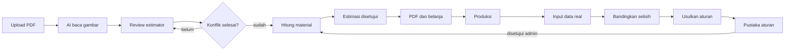
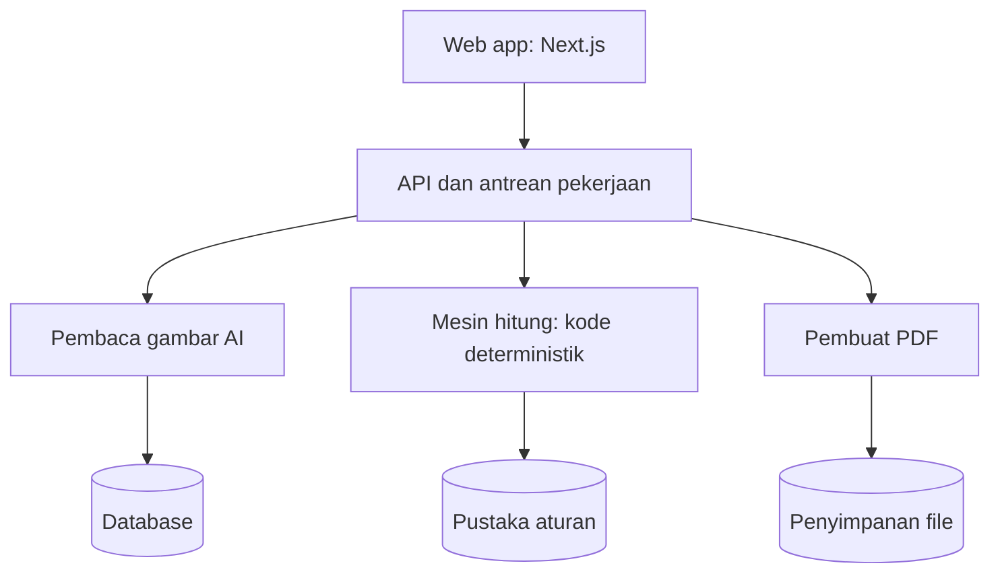

# PRD Web App Estimasi Material Interior

| Dokumen | Nilai |
| --- | --- |
| Versi | 1.0 |
| Tanggal | 5 November 2026 |
| Status | Draf untuk tim internal |
| Nama app | Estimasi Material (nama sementara) |
| Pasangan dokumen | `DESIGN.md` |

Web app ini mengubah PDF lembar kerja interior menjadi estimasi belanja material, lalu belajar dari data produksi real agar proyek berikutnya makin akurat. App dipakai oleh tim internal.

## 1. Masalah dan tujuan

Estimasi material saat ini dihitung manual dari gambar kerja, sehingga salah hitung baru terlihat saat produksi. App ini memberi estimator daftar belanja dalam hitungan menit, lengkap dengan asumsi dan konflik gambar yang harus dicek.

**Tujuan produk:**

- Satu PDF lembar kerja menghasilkan satu estimasi belanja yang bisa direview.
- Semua angka bisa ditelusuri ke ukuran gambar, asumsi, atau aturan.
- Data produksi real masuk kembali sebagai kalibrasi aturan.
- Hasil akhir keluar sebagai PDF yang mudah dibaca workshop dan purchasing.

**Baseline dari dua proyek real:**

| Proyek | Hasil estimasi awal | Data real | Pelajaran |
| --- | --- | --- | --- |
| Ibu Aulia, kabinet bawah | 2 + 1 + 1 + 1 lembar | 2 + 1 + 1 + 1 lembar | Empat bahan lembaran cocok persis |
| Ibu Septi, bahan 18 mm | 26 lembar | 25 lembar | Multi min 18, multi double 18, PVC 18, dan BB 18 min cocok persis |
| Ibu Septi, total papan | 33 lembar | 41 lembar | Multi polos 6 dan 9 belum ada di model |
| Ibu Septi, total HPL | 14 lembar | 18 lembar | Backsplash belum dihitung, 1 lembar HPL TH 852 J belum terjelaskan |
| Ibu Septi, total sekrup | 4.200 pcs | 1.320 pcs | Rasio per lembar salah, diganti rumus per fungsi |

Dua proyek ini belum cukup untuk memvalidasi semua rumus, jadi kalibrasi adalah fitur inti, bukan tambahan.

## 2. Pengguna dan peran

Pengguna utama adalah estimator di tim interior. Purchasing dan workshop memakai hasilnya tanpa harus membaca gambar kerja.

| Peran | Tugas di app | Hak akses |
| --- | --- | --- |
| Estimator | Upload PDF, review hasil baca, hitung, terbitkan estimasi | Buat dan ubah proyek |
| Kepala produksi | Menyetujui estimasi, input data real | Setujui dan input real |
| Purchasing | Melihat daftar belanja final, unduh PDF | Baca dan unduh |
| Admin | Kelola brand, material, aturan, dan pengguna | Semua akses |

App dimulai dari Putra Corporation. Satu workspace bisa punya banyak brand dengan logo dan katalog material sendiri.

## 3. Alur utama

Estimasi tidak bisa dihitung sebelum konflik gambar selesai. Setelah produksi, data real masuk dan menjadi usulan aturan untuk proyek berikutnya.

## 4. Cakupan

MVP fokus pada jalur penuh dari PDF ke daftar belanja, plus input data real. Harga dan integrasi ditunda karena tujuan pertama adalah akurasi jumlah.

| Area | MVP | Ditunda |
| --- | --- | --- |
| Input | Upload PDF lembar kerja | Impor SketchUp, foto gambar tangan |
| Pembacaan | Baca spek, unit, ukuran, catatan, dan konflik gambar | Baca otomatis tanpa review manusia |
| Perhitungan | Daftar potongan, nesting, hardware, bahan bantu | Optimasi lintas proyek untuk memakai sisa bahan |
| Hasil | PDF daftar material dan pola potong | Kirim ke mesin CNC |
| Kalibrasi | Input data real, perbandingan, usulan aturan | Penerapan aturan otomatis tanpa persetujuan |
| Biaya | Belum ada harga | Harga supplier, RAB, margin |
| Pengadaan | Unduh daftar belanja | Purchase order dan stok gudang |

## 5. Kebutuhan fungsional

Semua kebutuhan P0 wajib ada sebelum MVP dipakai di proyek nyata. P1 menyusul setelah alur inti stabil.

### 5.1 Proyek dan upload

| ID | Kebutuhan | Kriteria terima | Prioritas |
| --- | --- | --- | --- |
| FR-01 | Buat proyek dengan klien, lokasi, brand, surveyor, dan tanggal | Data terisi otomatis dari title block PDF dan bisa diubah | P0 |
| FR-02 | Upload PDF sampai 50 MB | Proyek 17 halaman seperti Ibu Septi terbaca tanpa gagal | P0 |
| FR-03 | Tampilkan thumbnail tiap halaman | Pengguna bisa membuka halaman dengan zoom | P0 |
| FR-04 | Simpan versi lembar kerja | PDF revisi menjadi versi baru tanpa menghapus versi lama | P1 |

### 5.2 Pembacaan lembar kerja

| ID | Kebutuhan | Kriteria terima | Prioritas |
| --- | --- | --- | --- |
| FR-10 | Baca spek: bahan utama per unit, finishing, kode HPL, rel, engsel | Tiap nilai menunjuk halaman sumbernya | P0 |
| FR-11 | Kenali unit: kabinet atas, kabinet bawah, box, lemari, wallpanel | Unit bisa ditambah, digabung, atau dihapus manual | P0 |
| FR-12 | Baca ukuran tertulis dan catatan request | Tiap ukuran punya status: gambar, skala, atau asumsi | P0 |
| FR-13 | Deteksi konflik gambar | Contoh: kulkas 70 x 177,5 vs 92 x 179, dan 52 + 85 tidak sama dengan 134 | P0 |
| FR-14 | Tandai ukuran yang belum ada | Hitung ditahan sampai pengguna mengisi atau menerima asumsi | P0 |

### 5.3 Review dan perhitungan

| ID | Kebutuhan | Kriteria terima | Prioritas |
| --- | --- | --- | --- |
| FR-20 | Layar review berdampingan: gambar di kiri, data di kanan | Klik nilai membuka lokasinya di PDF | P0 |
| FR-21 | Susun daftar potongan per unit dan bahan | Bisa diedit per baris, perubahan tercatat | P0 |
| FR-22 | Nesting per bahan dan ukuran lembar | Tidak ada part tumpang tindih, semua part masuk area pakai | P0 |
| FR-23 | Hitung hardware dari aturan | Tiap jumlah menunjukkan rumus dan unit asalnya | P0 |
| FR-24 | Hitung sekrup dan bahan bantu | Nilai diberi status: terkalibrasi atau perkiraan | P0 |
| FR-25 | Uji perubahan | Tampilkan efek trim, kerf, dan opsi bahan terhadap jumlah lembar | P1 |

### 5.4 Hasil dan persetujuan

| ID | Kebutuhan | Kriteria terima | Prioritas |
| --- | --- | --- | --- |
| FR-30 | Halaman hasil estimasi | Menampilkan papan, HPL, hardware, bantu, listrik, dan finishing | P0 |
| FR-31 | Daftar konfirmasi sebelum belanja | Item terbuka harus dijawab atau diterima sebelum disetujui | P0 |
| FR-32 | Alur status: draf, review, disetujui, belanja, selesai | Perubahan setelah disetujui membuat revisi baru | P0 |
| FR-33 | Ekspor PDF modern dan pola potong | Format mengikuti PDF Ibu Aulia dan Ibu Septi | P0 |
| FR-34 | Ekspor Excel | Daftar potongan dan belanja bisa dibuka di Excel | P1 |

### 5.5 Kalibrasi data real

| ID | Kebutuhan | Kriteria terima | Prioritas |
| --- | --- | --- | --- |
| FR-40 | Tempel data real dalam bentuk teks | Format ketikan seperti `multi min 18 : 11 lembar` terbaca otomatis | P0 |
| FR-41 | Cocokkan nama item dengan katalog | Alias seperti `multimin`, `multi min`, dan `multi 6` tersimpan | P0 |
| FR-42 | Tampilkan selisih estimasi dan real per item | Status: cocok, kurang, lebih, baru | P0 |
| FR-43 | Minta penjelasan selisih | Selisih besar bisa diberi alasan dari pengguna | P0 |
| FR-44 | Usulkan perubahan aturan | Aturan baru aktif hanya setelah disetujui admin | P0 |
| FR-45 | Tampilkan akurasi per bahan antarproyek | Tren selisih terlihat per bahan dan per brand | P1 |

### 5.6 Pustaka dan admin

| ID | Kebutuhan | Kriteria terima | Prioritas |
| --- | --- | --- | --- |
| FR-50 | Katalog material | Nama, alias, brand, ukuran lembar, tebal, dan satuan | P0 |
| FR-51 | Pustaka aturan | Tiap aturan punya versi, sumber proyek, dan tingkat keyakinan | P0 |
| FR-52 | Pengaturan brand | Logo, warna, dan format PDF per brand | P1 |
| FR-53 | Kelola pengguna dan peran | Akses mengikuti tabel peran | P0 |

## 6. Mesin hitung

Mesin hitung bersifat deterministik: AI hanya membaca gambar, sedangkan jumlah bahan dihitung oleh kode dan aturan. Dengan begitu, input yang sama selalu menghasilkan angka yang sama.

### 6.1 Parameter dasar

| Parameter | Nilai awal | Catatan |
| --- | --- | --- |
| Ukuran papan dan HPL | 1220 x 2440 mm | Bisa diubah per material |
| AICA Cerarl | 935 x 2455 x 3 mm | Dari daftar produk XKAF 14165 ZMN |
| Tebal potong | 3,2 mm | Mata 10 inci, tebal potong aktual belum diukur |
| Trim tepi lembar | 0 mm | Uji perubahan memakai 10 mm |
| Kelebihan HPL per part | +10 mm | Untuk trim setelah lapis |
| Metode nesting | Potong lurus tembus | Sesuai meja gergaji |
| Arah serat | HPL kayu tidak diputar | HPL polos boleh diputar |

### 6.2 Aturan bahan

| Bagian | Aturan | Sumber |
| --- | --- | --- |
| Badan dan pintu | 18 mm satu muka: melamin ke dalam, sisi polos untuk HPL | Aulia, Septi |
| Sekat dan ambalan | 18 mm dua muka, termasuk lemari | Septi |
| Bilik unit kayu | Multi 6 | Aulia, Septi |
| Bilik kabinet PVC | PVC 6 | Septi |
| Backsplash | Multi polos 6 + HPL TH 009 D | Septi, perlu konfirmasi |
| Dudukan top dan lis tepi | Multi polos 9 | Septi, baru menjelaskan 2 dari 3 lembar |

### 6.3 Aturan hardware

| Item | Aturan | Sumber |
| --- | --- | --- |
| Engsel | 1 pasang per pintu | Aulia, Septi |
| Engsel full tekuk | Pintu inset lemari | Septi, perlu konfirmasi |
| Engsel robot | 1 pasang per sudut | Septi |
| Rel | 1 pasang per unit tarik | Aulia, Septi |
| Ukuran rel | Kabinet Rel 50, laci lemari Rel 45 | Septi, Aulia berbeda |
| Hidrolik | 1 pasang untuk pintu rak piring | Septi, perlu konfirmasi |
| Ventilasi | Pintu sink dan pintu gas | Aulia, Septi |
| Rak sendok | Laci atas kabinet bawah | Aulia, Septi |

### 6.4 Rumus sekrup

Rumus ini dikalibrasi dari satu proyek, jadi statusnya masih perkiraan sampai ada data proyek lain.

| Item | Rumus | Hasil Septi | Real Septi |
| --- | --- | --- | --- |
| Sekrup 5/8 | Jumlah engsel x 4 + pasang rel x 14 | 300 | 300 |
| Sekrup 7 dan fisher | Meter kabinet gantung x 3 | 20 | 20 |
| GP 3 + GP 5 | Titik sambungan x 1,3, dibagi 1 : 1 | 1.002 | 1.000 |
| Minimum proyek kecil | 500 pcs total | Tidak berlaku | Aulia memakai 500 |

### 6.5 Status setiap angka

| Status | Arti | Tampilan |
| --- | --- | --- |
| Gambar | Ukuran atau jumlah tertulis di lembar kerja | Biasa |
| Skala | Dibaca dari skala gambar | Tanda sedang |
| Asumsi | Diisi dari standar proyek | Tanda kuat |
| Terkalibrasi | Rumus sudah cocok pada beberapa proyek | Biasa |
| Perkiraan | Rumus belum cukup data | Label perkiraan |

## 7. Model data

Satu proyek bisa punya banyak versi estimasi, dan setiap estimasi menyimpan versi aturan yang dipakai. Ini membuat hasil lama tetap bisa diulang.

| Entitas | Isi utama | Relasi |
| --- | --- | --- |
| Workspace | Nama, pengaturan | Punya banyak Brand dan User |
| Brand | Nama, logo, warna | Punya banyak Project |
| User | Nama, email, peran | Anggota Workspace |
| Project | Klien, lokasi, status, tanggal gambar | Punya banyak Worksheet dan Estimate |
| Worksheet | File PDF, versi, jumlah halaman | Punya banyak ExtractedField |
| ExtractedField | Nilai, halaman, posisi, status, keyakinan | Milik Worksheet |
| Conflict | Jenis, nilai yang bertentangan, jawaban | Milik Worksheet |
| Unit | Nama, bahan utama, dimensi | Milik Estimate |
| Part | Nama, panjang, lebar, jumlah, status ukuran | Milik Unit, memakai Material |
| Material | Nama, alias, tebal, ukuran lembar, satuan, arah serat | Milik Workspace |
| Estimate | Versi, status, parameter, RuleSet | Punya banyak Unit dan EstimateLine |
| EstimateLine | Material, jumlah, rumus, status | Milik Estimate |
| CutSheet | Bahan, nomor lembar, isi persen, posisi part | Milik Estimate |
| ActualList | Teks asli, tanggal, penginput | Milik Project |
| ActualLine | Material, jumlah, alasan selisih | Milik ActualList |
| Rule | Kategori, rumus, sumber proyek, keyakinan | Milik RuleSet |
| RuleSet | Versi, status, penyetuju | Milik Workspace |

## 8. Arsitektur

Stack yang diusulkan: Next.js, PostgreSQL, penyimpanan objek, dan worker Python untuk nesting. Pilihan ini bisa berubah mengikuti tim developer.

## 9. Layar UI

Desain terdiri dari tujuh layar desktop yang mengikuti alur kerja estimator. Detail tampilan ada di `DESIGN.md`.

| Layar | Tujuan | Isi utama | Kebutuhan |
| --- | --- | --- | --- |
| Daftar Proyek | Melihat semua proyek dan statusnya | Tabel proyek, status, jumlah konflik, akurasi | FR-01, FR-32 |
| Proyek Baru | Upload PDF | Area upload, progres baca, thumbnail halaman | FR-01 s.d. FR-03 |
| Review Lembar Kerja | Memeriksa hasil baca | PDF di kiri, spek, unit, ukuran, dan konflik di kanan | FR-10 s.d. FR-14, FR-20 |
| Hasil Estimasi | Melihat daftar belanja | Ringkasan, daftar per kategori, konfirmasi, ekspor PDF | FR-23, FR-24, FR-30 s.d. FR-33 |
| Pola Potong | Memeriksa nesting | Pilih bahan, peta lembar, isi persen, daftar part | FR-21, FR-22, FR-25 |
| Data Real | Membandingkan hasil | Tempel teks, tabel selisih, alasan, usulan aturan | FR-40 s.d. FR-44 |
| Pustaka Aturan | Mengelola aturan | Daftar aturan, rumus, sumber, keyakinan, persetujuan | FR-50, FR-51 |

## 10. Kebutuhan non-fungsional

Target berikut adalah usulan awal dan perlu disesuaikan setelah uji di proyek nyata.

| Area | Kebutuhan |
| --- | --- |
| Kecepatan | Pembacaan PDF 17 halaman selesai di bawah 3 menit, dengan progres per halaman |
| Kecepatan hitung | Nesting 10 jenis bahan selesai di bawah 2 menit |
| Konsistensi | Input dan versi aturan yang sama menghasilkan angka yang sama |
| Keamanan | PDF klien hanya bisa dibuka anggota workspace, file dienkripsi saat disimpan |
| Privasi | Data klien tidak dipakai untuk melatih model AI pihak ketiga |
| Jejak audit | Semua perubahan angka mencatat pengguna, waktu, nilai lama, dan nilai baru |
| Perangkat | Dioptimalkan untuk desktop, hasil estimasi tetap terbaca di ponsel |
| Bahasa | Antarmuka bahasa Indonesia, satuan mm, cm, lembar, psg, dan pcs |
| Ketersediaan | Pekerjaan baca dan nesting tetap berjalan saat browser ditutup |

## 11. Metrik sukses

Metrik utama adalah selisih jumlah lembar antara estimasi dan data real. Target di bawah adalah usulan untuk 10 proyek pertama.

| Metrik | Baseline | Target |
| --- | --- | --- |
| Selisih total papan | Septi: 33 vs 41 lembar | Maksimal 1 lembar per 10 lembar |
| Selisih total HPL | Septi: 14 vs 18 lembar | Maksimal 1 lembar per 10 lembar |
| Bahan 18 mm cocok persis | Septi: 4 dari 5 jenis | Minimal 80% jenis bahan |
| Selisih sekrup | Septi: 4.200 vs 1.320 pcs | Maksimal 20% |
| Waktu estimasi | Belum diukur | Di bawah 30 menit per proyek kecil |
| Proyek dengan data real masuk | 2 proyek | Minimal 80% proyek selesai |
| Konflik gambar tertangkap | 2 konflik Septi tertangkap manual | Minimal 90% konflik sebelum belanja |

## 12. Roadmap

Durasi adalah usulan dan perlu disesuaikan dengan ukuran tim developer. Fase berikutnya hanya dimulai setelah gerbangnya lolos.

| Fase | Durasi usulan | Isi | Gerbang keluar |
| --- | --- | --- | --- |
| 0. Validasi | 2 minggu | Uji mesin di 5 proyek, jawab pertanyaan terbuka | Selisih lembar sesuai target |
| 1. MVP | 6 minggu | Upload, review, hitung, hasil, PDF, pola potong, data real dasar | 3 proyek nyata lewat app |
| 2. Kalibrasi | 4 minggu | Usulan aturan, akurasi per bahan, Excel, revisi | 10 proyek memenuhi metrik |
| 3. Pengadaan | Setelah akurasi stabil | Harga supplier, RAB, purchase order, sisa bahan | Tidak ada |

## 13. Risiko dan pertanyaan terbuka

Risiko terbesar adalah angka terlihat pasti padahal berasal dari asumsi. Karena itu, setiap angka wajib menampilkan statusnya.

| Risiko | Dampak | Penanganan |
| --- | --- | --- |
| AI salah membaca ukuran | Jumlah lembar salah | Review wajib dan tautan ke lokasi di PDF |
| Gambar tidak mencantumkan ukuran | Banyak asumsi | Status skala dan asumsi, plus standar workshop |
| Aturan hanya dari sedikit proyek | Akurasi tidak stabil | Label perkiraan sampai data cukup |
| Data real tidak diinput | Kalibrasi berhenti | Proyek tidak bisa ditutup tanpa data real |
| Nama bahan berbeda antarorang | Pencocokan gagal | Alias material dan konfirmasi manual |

**Pertanyaan yang perlu dijawab:**

- [ ] Multi polos 6 dan multi polos 9 dipakai untuk bagian apa saja?
- [ ] Tambahan 1 lembar PVC 6 dan 1 lembar HPL TH 852 J terpakai untuk apa, atau itu cadangan?
- [ ] Pintu mana yang tidak memakai engsel lurus, karena hitungan gambar 22 pasang dan data real 16 pasang?
- [ ] Apakah AICA, kaca, dan hanger tarik dibeli terpisah dari daftar material?
- [ ] Berapa tebal potong mata gergaji 10 inci yang dipakai workshop?
- [ ] Berapa estimator yang akan memakai app di bulan pertama?
